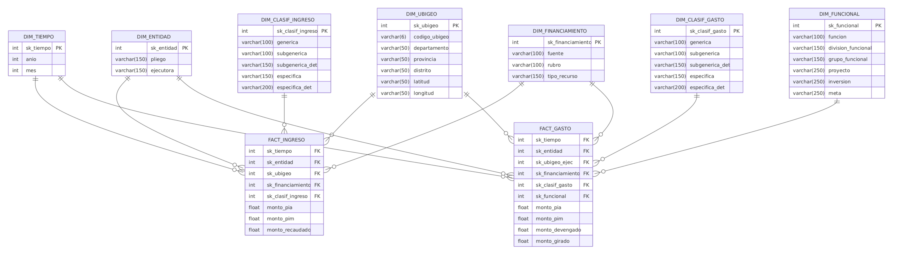
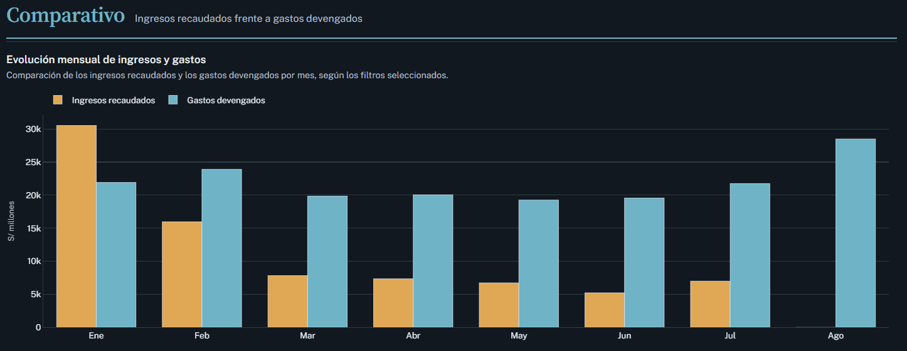
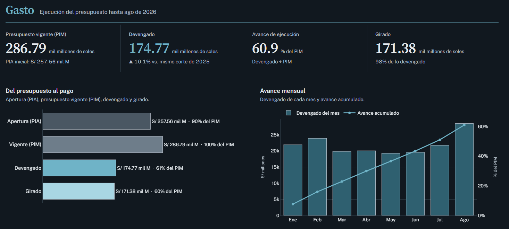
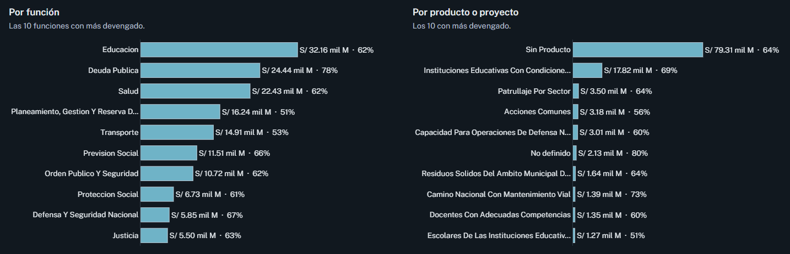
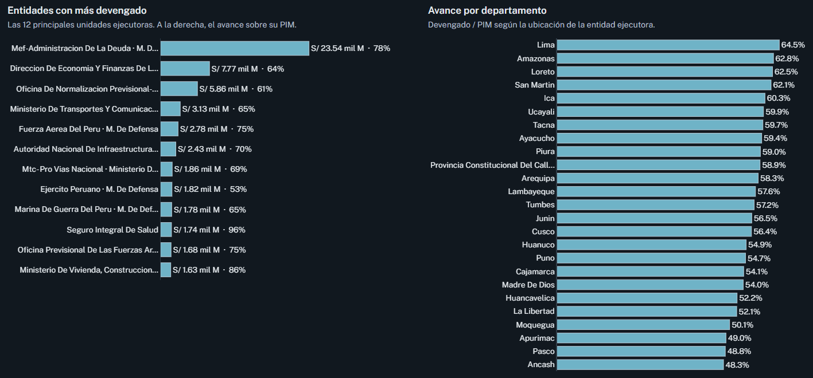
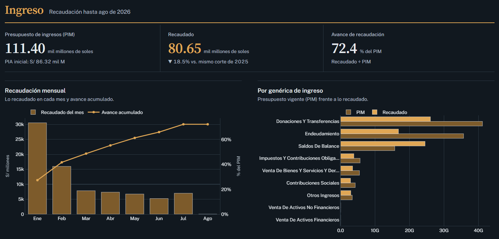
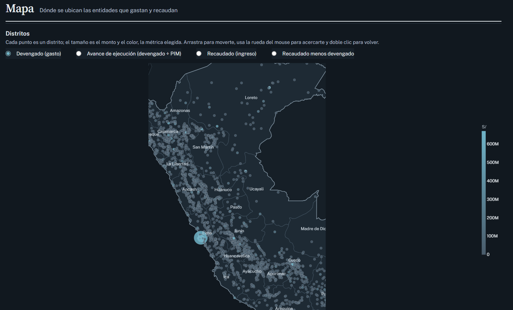

# BI_Budget_Intelligence_Peru
Large scale Budgeting Analysis Tool using open data from the Peruvian government's platform

Herramienta de análisis presupuestal a gran escala construida sobre los datos abiertos del Ministerio de Economía y Finanzas (MEF) del Perú.

## Integrantes:

* Abel Montes de Oca
* Rodrigo Bisetti
* María Mendoza
* Ximena Ramírez

## Enlaces del proyecto
| Dashboard | Presentación | Consultas SQL |
|---|---|---|
| [Dashboard](https://dashboard.pongan-bachata.org) | [Canva](https://canva.link/adbv61jc2wj1r1f) | [CloudBeaver](https://dbeaver.pongan-bachata.org) |

## Índice

1. [Contexto](#1-contexto)
2. [Descripción de la institución](#2-descripción-de-la-institución)
3. [Fuentes de datos](#3-fuentes-de-datos)
4. [Problemática](#4-problemática)
5. [Objetivos](#5-objetivos)
6. [Marco teórico](#6-marco-teórico)
7. [Modelamiento multidimensional](#7-modelamiento-multidimensional)
8. [Proceso ETL y arquitectura](#8-proceso-etl-y-arquitectura)
9. [Herramientas utilizadas](#9-herramientas-utilizadas)
10. [Dashboard y resultados](#10-dashboard-y-resultados)
11. [Propuesta de mejora](#11-propuesta-de-mejora)
12. [Factibilidad](#12-factibilidad)
13. [Conclusiones](#13-conclusiones)
14. [Recomendaciones](#14-recomendaciones)
15. [Referencias](#referencias)

# 1. Contexto

El presupuesto público del Perú se administra a través del SIAF, el sistema del Ministerio de Economía y Finanzas (MEF) donde más de 2,500 entidades entre pliegos, gobiernos regionales y locales registran su programación y ejecución. El proceso sigue el ciclo formal del gasto (PIA, PIM, devengado, girado) y del ingreso (recaudación), bajo el enfoque de Presupuesto por Resultados.

El MEF publica esta información como datos abiertos y a través de Consulta Amigable, pero en un formato pensado para el registro y la consulta puntual, no para el análisis comparativo. No hay una vista que permita ver, por ejemplo, cuánto recauda una región frente a lo que ejecuta.

La descentralización fiscal, vigente desde inicios de los 2000, multiplicó el número de unidades ejecutoras y con ello la heterogeneidad de la data. Este proyecto construye un Data warehouse de inteligencia de negocios sobre la data abierta del MEF (ámbito Proyectos de Inversión) para medir, comparar y explicar la ejecución presupuestal pública desde el año 2023 hasta el presente 2026 (con una fecha de corte en Agosto).

# 2. Descripción de la institución

El proyecto se construye sobre información del Ministerio de Economía y Finanzas del Perú (MEF), específicamente de la Dirección General de Presupuesto Público (DGPP), ente rector del presupuesto público. El MEF define los clasificadores oficiales de ingreso, gasto y clasificación funcional programática, y administra el SIAF, el sistema donde todas las entidades públicas registran su presupuesto.

Como mecanismo de transparencia, el MEF publica esta data a través de Consulta Amigable (`apps5.mineco.gob.pe/transparencia/Navegador`), la fuente usada en este proyecto para los años 2023 a 2026, ámbito Proyecto. Ahí se puede consultar, por entidad, el PIA, el PIM, el devengado, el girado y el recaudado, desagregados por fuente de financiamiento y clasificación funcional programática: exactamente las dimensiones sobre las que se construye este datawarehouse.

El MEF no es una empresa privada, así que el "cliente" de esta solución se entiende en sentido amplio: funcionarios públicos, órganos de control y ciudadanos que hoy no cuentan con una herramienta que traduzca esta data en indicadores accionables.

# 3. Fuentes de datos

a) Presupuesto y Ejecución de Gasto. Fuente: Ministerio de Economía y Finanzas, Datos Abiertos. https://www.datosabiertos.gob.pe/dataset/presupuesto-y-ejecución-de-gasto

b) Presupuesto y Ejecución de Ingreso. Fuente: Ministerio de Economía y Finanzas, Datos Abiertos. https://www.datosabiertos.gob.pe/dataset/presupuesto-y-ejecución-de-ingreso

c) Tabla de Ubigeos del Perú al 2021. Fuente: Datos abiertos. https://www.datosabiertos.gob.pe/dataset/codigos-equivalentes-de-ubigeo-del-peru/resource/4a035ef3-8c50-4a4c-a11b-45a0777aedb3

Conversión y almacenamiento de datos: Los archivos (formato CSV) fueron transformados al formato Parquet mediante la biblioteca DuckDB en Python, con el objetivo de optimizar su almacenamiento y procesamiento. Los archivos resultantes se encuentran disponibles en el siguiente enlace de Google Drive: (https://drive.google.com/drive/folders/16SBvEmBFvqbuuqwO0WiikVK3rTC7Y7Pv?usp=sharing).

# 4. Problemática

Los datos que publica el MEF vienen en archivos planos separados por dataset: uno para ingreso y otro para gasto. Cada uno usa sus propios códigos y nombres de columna, sin una llave común para cruzarlos. Esto obliga a limpiar y unir las tablas a mano antes de poder responder algo tan simple como cuánto ejecutó una entidad frente a lo presupuestado.

Consulta Amigable, la herramienta oficial del MEF, separa ambos lados en módulos distintos: existe una "Consulta Amigable de Ingresos" (presupuesto y ejecución de ingresos) y una consulta aparte para el gasto, cada una con su propio navegador, sus filtros y sus totales. Se puede ver cuánto recaudó o cuánto ejecutó una entidad, pero no ambos bajo los mismos filtros y en una misma vista. Para saber si un territorio gasta más de lo que recauda, hay que consultar cada módulo por separado, igualar a mano los criterios (año, mes de corte, nivel de gobierno, fuente de financiamiento) y cruzar los resultados manualmente con una base externa de ubigeos.

Esto afecta tanto a funcionarios públicos, que necesitan comparar su ejecución con la de entidades similares, como a ciudadanos que quieren fiscalizar el gasto de su región sin cruzar reportes a mano. Ninguno de los dos puede hoy explorar el cruce ingreso gasto al nivel de detalle que necesita.

Este proyecto busca cubrir ese vacío, un modelo dimensional que integre ingreso, gasto y ubicación en una sola estructura con un dashboard donde los mismos filtros (año, mes de corte, nivel de gobierno, departamento y fuente de financiamiento) se apliquen a ambos lados, con un gráfico comparativo mensual de ingresos recaudados frente a gastos devengados y un mapa que permite ver la diferencia entre lo recaudado y lo devengado por distrito.

# 5. Objetivos

## Objetivo general

Diseñar e implementar un Data warehouse de inteligencia de negocios que integre el presupuesto y la ejecución del gasto con el presupuesto y la recaudación del ingreso público del MEF (años 2023 a 2026), utilizando un modelo dimensional y un dashboard con filtros comunes que faciliten el análisis temporal, institucional, presupuestal y geográfico de los recursos públicos.

## Objetivos específicos

1. *Integrar y estandarizar* los conjuntos de datos de presupuesto y ejecución del gasto y del ingreso correspondientes a los años 2023, 2024, 2025 y 2026 provenientes de las fuentes de datos abiertos del MEF.

2. *Transformar y almacenar los datos en formato Parquet*, reduciendo las limitaciones asociadas al procesamiento de los archivos CSV originales, convirtiéndolos a formato Parquet con DuckDB y facilitando el acceso a las variables necesarias durante el procesamiento y análisis de la información.

3. *Diseñar e implementar un modelo dimensional* que organice la información mediante dos tablas de hechos con `FACT_GASTO` y `FACT_INGRESO`, que comparten las dimensiones tiempo, entidad, ubigeo y financiamiento.

4. *Poblar el Data Warehouse* en SQL Server mediante un proceso ETL reproducible.

5. *Consolidar las principales métricas presupuestales* necesarias para el análisis, considerando el Presupuesto Institucional de Apertura (PIA), el Presupuesto Institucional Modificado (PIM), el monto devengado, el monto girado y el monto recaudado.
   
6. *Calcular indicadores:* avance de ejecución (devengado ÷ PIM), avance de recaudación (recaudado ÷ PIM) y diferencia entre lo recaudado y lo devengado.
   
7. *Incorporar información geográfica mediante códigos UBIGEO, latitud y longitud*, permitiendo analizar territorialmente la ejecución presupuestal y desarrollar visualizaciones geográficas mediante mapas.

8. *Desarrollar un dashboard* con secciones de gasto, ingreso, comparativo mensual (recaudado vs devengado) y mapa, con filtros comunes de año, mes de corte, nivel de gobierno, departamento y fuente de financiamiento.

9. *Desplegar el Data warehouse y el dashboard* con Docker y publicarlos en línea para su consulta.

# 6. Marco teórico

## 6.1 Business Intelligence y data warehousing

### 6.1.1 Business Intelligence

Conjunto de sistemas que combinan recolección, almacenamiento y gestión del conocimiento con herramientas analíticas, para presentar información compleja a quienes toman decisiones (Negash, 2004). En este proyecto, BI se aplica sobre la información presupuestal del MEF con fines comparativos.

### 6.1.2 Data warehouse

Colección de datos orientada a temas, integrada, no volátil y variante en el tiempo, que sirve de soporte a la toma de decisiones (Inmon, 2005). A diferencia de los sistemas transaccionales (OLTP), optimizados para registrar operaciones individuales, el data warehouse está diseñado para consultas analíticas sobre grandes volúmenes de datos históricos (Chaudhuri & Dayal, 1997).

### 6.1.3 Modelamiento dimensional

Organiza los datos en tablas de hechos, que guardan las mediciones numéricas de un proceso de negocio, y tablas de dimensiones, que dan el contexto de esas mediciones: quién, qué, dónde, cuándo y cómo (Kimball & Ross, 2013).

## 6.2 Presupuesto público del Perú

### 6.2.1 Sistema Nacional de Presupuesto Público

Conjunto de normas, procesos e instituciones que organiza cómo el Estado peruano asigna, ejecuta y evalúa sus recursos. Está regulado por el Decreto Legislativo N.° 1440, y su ente rector es la DGPP del MEF, encargada de fijar las reglas y clasificadores que todas las entidades deben aplicar (Decreto Legislativo N.° 1440, 2018).

### 6.2.2 Sistema Integrado de Administración Financiera (SIAF)

Sistema informático del MEF donde las entidades públicas registran la programación y ejecución de su presupuesto. Es el sistema transaccional de las finanzas públicas, y de ahí provienen los datos abiertos que publica el MEF.

### 6.2.3 Pliego y unidad ejecutora

El pliego es la entidad a la que se le aprueba un presupuesto: un ministerio, un gobierno regional, una municipalidad. La unidad ejecutora es la dependencia dentro del pliego que administra los recursos, y es el nivel más detallado en el que se registra la ejecución (Decreto Legislativo N.° 1440, 2018).

### 6.2.4 Presupuesto Institucional de Apertura (PIA)

Presupuesto aprobado para una entidad al inicio del año fiscal, tanto en ingresos como en gastos (Decreto Legislativo N.° 1440, 2018).

### 6.2.5 Presupuesto Institucional Modificado (PIM)

Presupuesto actualizado de una entidad, resultado de sumar al PIA las modificaciones aprobadas durante el año, como transferencias o créditos adicionales (Decreto Legislativo N.° 1440, 2018). Representa los recursos con los que la entidad realmente cuenta, por lo que es la referencia habitual para evaluar su gestión.

### 6.2.6 Devengado

Fase del gasto en la que se reconoce la obligación de pagar, una vez recibido conforme el bien o servicio. La precede la certificación (reserva del presupuesto) y el compromiso (acuerdo con el proveedor) (Decreto Legislativo N.° 1440, 2018). Se considera la medida estándar de ejecución, porque indica que el gasto ya se concretó.

### 6.2.7 Girado

Fase final del gasto, en la que se emite el pago y se cancela la obligación reconocida en el devengado.

### 6.2.8 Avance de ejecución

Indicador que mide qué proporción de su presupuesto ha gastado una entidad. Se calcula dividiendo el monto devengado entre el PIM.

### 6.2.9 Recaudado

Monto de ingresos que una entidad efectivamente percibe en un periodo, ya sea por impuestos, tasas, transferencias u otras fuentes.

### 6.2.10 Fuente de financiamiento y rubro

Categorías que identifican el origen de los recursos públicos. La fuente agrupa los recursos según su procedencia general (recursos ordinarios, recursos determinados), y el rubro la desagrega (canon y sobrecanon, regalías, renta de aduanas) (Decreto Legislativo N.° 1440, 2018).

### 6.2.11 Clasificadores económicos de ingresos y gastos

Catálogos jerárquicos del MEF que agrupan los ingresos según su naturaleza (impuestos, transferencias) y los gastos según el tipo de bien o servicio adquirido (planillas, bienes y servicios, obras).

### 6.2.12 Clasificación funcional y estructura programática

La clasificación funcional agrupa el gasto según las grandes áreas de acción del Estado: educación, salud, transporte. La estructura programática lo vincula con los programas presupuestales, productos y proyectos a los que se destina. Ambas convergen en la meta presupuestal, la unidad mínima de programación del gasto dentro de una entidad.


# 7. Modelamiento multidimensional

El modelo está compuesto por dos tablas de hechos: `FACT_INGRESO` y `FACT_GASTO`. Ambas comparten las dimensiones conformadas `DIM_TIEMPO`, `DIM_ENTIDAD`, `DIM_UBIGEO` y `DIM_FINANCIAMIENTO`, lo que permite comparar ingresos y gastos bajo un mismo contexto temporal, institucional, territorial y de fuente de financiamiento. Además, cada tabla de hechos se relaciona con dimensiones propias que describen la naturaleza económica, funcional y programática de los montos. La dimensiones exclusiva de ingreso es `DIM_CLASIF_INGRESO`; mientras que las de gasto son `DIM_CLASIF_GASTO` y `DIM_FUNCIONAL`.

A continuación, se presenta la descripción de las tablas que conforman el modelo dimensional.

## Diccionario de datos

### DIM_TIEMPO
 
La dimensión tiempo almacena la información temporal asociada a los registros de ingreso y gasto. Su granularidad es mensual, en concordancia con la frecuencia de publicación de los datos del MEF, y permite realizar análisis de evolución y acumulados a lo largo del año fiscal. En el gasto corresponde al periodo de ejecución del presupuesto; en el ingreso, al periodo del documento de recaudación.
 
| Nombre de columna | Tipo de dato | Descripción |
|---|---|---|
| sk_tiempo | INT | Identificador único de la dimensión tiempo (clave subrogada). |
| anio | INT | Año de ejecución del presupuesto (gasto) o año del documento en que se realizó la recaudación (ingreso). Origen: `ANO_EJE` / `ANO_DOC`. |
| mes | INT | Mes de ejecución del presupuesto (gasto) o mes del documento de recaudación (ingreso), del 1 al 12. Origen: `MES_EJE` / `MES_DOC`. |
 
---
 
### DIM_ENTIDAD
 
La dimensión entidad almacena la información de las instituciones públicas que recaudan ingresos y ejecutan gasto. Su nivel de detalle es la unidad ejecutora, identificada por el MEF mediante un código secuencial único (`SEC_EJEC`), y se organiza jerárquicamente dentro de un pliego presupuestal.
 
| Nombre de columna | Tipo de dato | Descripción |
|---|---|---|
| sk_entidad | INT | Identificador único de la dimensión entidad (clave subrogada). Se genera a partir del código que identifica a la entidad. Origen: `SEC_EJEC`. |
| pliego | VARCHAR(150) | Descripción del pliego al que pertenece la entidad (por ejemplo, un ministerio, gobierno regional o municipalidad). Origen: `PLIEGO_NOMBRE`. |
| ejecutora | VARCHAR(150) | Nombre de la entidad o unidad ejecutora responsable de la recaudación o del gasto. Origen: `EJECUTORA_NOMBRE`. |
 
---
 
### DIM_UBIGEO
 
La dimensión ubigeo almacena la información geográfica del lugar donde se ubica la entidad, según la división político-administrativa del Perú.
 
| Nombre de columna | Tipo de dato | Descripción |
|---|---|---|
| sk_ubigeo | INT | Identificador único de la dimensión ubigeo (clave subrogada). |
| codigo_ubigeo | VARCHAR(6) | Código de Ubicación Geográfica (UBIGEO) del INEI que identifica de forma única al distrito donde se ubica la entidad, compuesto por los dos dígitos de departamento, dos de provincia y dos de distrito. |
| departamento | VARCHAR(50) | Nombre del departamento donde se ubica la entidad. Origen: `DEPARTAMENTO_EJECUTORA_NOMBRE`. |
| provincia | VARCHAR(50) | Nombre de la provincia del departamento donde se ubica la entidad. Origen: `PROVINCIA_EJECUTORA_NOMBRE`. |
| distrito | VARCHAR(50) | Nombre del distrito de la provincia del departamento donde se ubica la entidad. Origen: `DISTRITO_EJECUTORA_NOMBRE`. |
| latitud | VARCHAR(50) | Coordenada de latitud del distrito, expresada en grados decimales y asociada a `codigo_ubigeo`. |
| longitud | VARCHAR(50) | Coordenada de longitud del distrito, expresada en grados decimales y asociada a `codigo_ubigeo`. |
---
 
### DIM_FINANCIAMIENTO
 
La dimensión financiamiento almacena el origen de los recursos públicos, organizado en tres niveles: fuente de financiamiento, rubro y tipo de recurso. Es una dimensión conformada que permite comparar, para un mismo rubro, cuánto se recaudó y cuánto se gastó.
 
| Nombre de columna | Tipo de dato | Descripción |
|---|---|---|
| sk_financiamiento | INT | Identificador único de la dimensión financiamiento (clave subrogada). |
| fuente | VARCHAR(100) | Descripción de la fuente de financiamiento, que agrupa a uno o más rubros (Recursos Ordinarios, Recursos Directamente Recaudados, Recursos por Operaciones Oficiales de Crédito, Donaciones y Transferencias, Recursos Determinados). Origen: `FUENTE_FINANCIAMIENTO_NOMBRE`. |
| rubro | VARCHAR(100) | Descripción del rubro que puede utilizar la entidad, es decir, de dónde provienen los recursos (por ejemplo, Canon y sobrecanon, regalías, renta de aduanas y participaciones). Origen: `RUBRO_NOMBRE`. |
| tipo_recurso | VARCHAR(150) | Descripción del tipo de recurso, que desagrega el rubro. Origen: `TIPO_RECURSO_NOMBRE`. |
 
---
 
### DIM_CLASIF_INGRESO
 
La dimensión clasificador de ingreso almacena la clasificación económica de los recursos que se recaudan, captan u obtienen, según el Clasificador de Ingresos del MEF. Permite identificar la naturaleza de cada ingreso, como impuestos, transferencias, endeudamiento o saldos de balance.
 
| Nombre de columna | Tipo de dato | Descripción |
|---|---|---|
| sk_clasif_ingreso | INT | Identificador único de la dimensión clasificador de ingreso (clave subrogada). |
| generica | VARCHAR(100) | Genérica de ingreso, el mayor nivel de agregación de los clasificadores de ingreso (por ejemplo, Impuestos y contribuciones obligatorias, Saldos de balance). Origen: `GENERICA_NOMBRE`. |
| subgenerica | VARCHAR(100) | Subgenérica de ingreso, nivel intermedio de desagregación que permite detallar la categoría de la genérica. Origen: `SUBGENERICA_NOMBRE`. |
| subgenerica_det | VARCHAR(150) | Subgenérica detalle de ingreso, nivel que desagrega la subgenérica y permite identificar con mayor precisión la naturaleza del ingreso. Origen: `SUBGENERICA_DET_NOMBRE`. |
| especifica | VARCHAR(150) | Específica de ingreso, nivel de clasificación que detalla la naturaleza del ingreso dentro de la subgenérica detalle. Origen: `ESPECIFICA_NOMBRE`. |
| especifica_det | VARCHAR(200) | Específica detalle, el nivel de agregación más específico y detallado que identifica y clasifica los recursos. Origen: `ESPECIFICA_DET_NOMBRE`. |
 
---
 
### DIM_CLASIF_GASTO
 
La dimensión clasificador de gasto almacena la clasificación económica del gasto según el Clasificador de Gastos del MEF. Permite identificar en qué se utilizan los recursos, como planillas, bienes y servicios o inversión en activos.
 
| Nombre de columna | Tipo de dato | Descripción |
|---|---|---|
| sk_clasif_gasto | INT | Identificador único de la dimensión clasificador de gasto (clave subrogada). |
| generica | VARCHAR(100) | Genérica de gasto, el mayor nivel de agregación de los clasificadores de gasto (por ejemplo, Personal y obligaciones sociales, Bienes y servicios, Adquisición de activos no financieros). Origen: `GENERICA_NOMBRE`. |
| subgenerica | VARCHAR(100) | Subgenérica de gasto, nivel intermedio de desagregación que permite detallar la categoría de la genérica. Origen: `SUBGENERICA_NOMBRE`. |
| subgenerica_det | VARCHAR(150) | Subgenérica detalle de gasto, nivel que desagrega la subgenérica y permite identificar con mayor precisión la naturaleza del gasto. Origen: `SUBGENERICA_DET_NOMBRE`. |
| especifica | VARCHAR(150) | Específica de gasto, nivel de clasificación que detalla la naturaleza del gasto dentro de la subgenérica detalle. Origen: `ESPECIFICA_NOMBRE`. |
| especifica_det | VARCHAR(200) | Específica de nivel 2, que identifica el detalle del gasto. Es el nivel más desagregado del clasificador. Origen: `ESPECIFICA_DET_NOMBRE`. |
 
---
 
### DIM_FUNCIONAL
 
La dimensión funcional almacena las metas presupuestales junto con su clasificación funcional y programática. Su granularidad es la meta, que es la unidad mínima de programación del gasto dentro de cada entidad y se identifica por la combinación de la entidad (`SEC_EJEC`) y el código de meta (`SEC_FUNC`).
 
Esta dimensión desnormaliza dos clasificaciones del gasto: la funcional (función → división funcional → grupo funcional) y la programática (producto o proyecto → actividad, acción de inversión u obra). Ambas se integran en una sola tabla porque convergen en la meta: según el MEF, cada meta corresponde a una combinación única de función, división funcional, grupo funcional, producto o proyecto y actividad, diferenciada por su finalidad.
 
| Nombre de columna | Tipo de dato | Descripción |
|---|---|---|
| sk_funcional | INT | Identificador único de la dimensión funcional (clave subrogada). Se genera a partir de la combinación de `SEC_EJEC` y `SEC_FUNC`. |
| funcion | VARCHAR(100) | Función, el nivel máximo de agregación de las acciones orientadas a la ejecución de un determinado tema (por ejemplo, Educación, Salud, Transporte). Origen: `FUNCION_NOMBRE`. |
| division_funcional | VARCHAR(150) | División funcional, el nivel intermedio de agregación de las acciones orientadas a la ejecución de un determinado tema. Origen: `DIVISION_FUNCIONAL_NOMBRE`. |
| grupo_funcional | VARCHAR(150) | Grupo funcional, el tercer y más desagregado nivel de la clasificación funcional. Origen: `GRUPO_FUNCIONAL_NOMBRE`. |
| proyecto | VARCHAR(250) | Descripción del producto o proyecto al que se destina el gasto. Origen: `PRODUCTO_PROYECTO_NOMBRE`. |
| inversion | VARCHAR(250) | Descripción de la actividad, acción de inversión u obra que se ejecuta. Origen: `ACTIVIDAD_ACCION_OBRA_NOMBRE`. |
| meta | VARCHAR(250) | Descripción de la finalidad de la meta presupuestal. Origen: `META_NOMBRE`. |
 
---
 
### FACT_INGRESO
 
La tabla de hechos de ingreso almacena los montos presupuestados y recaudados por las entidades públicas. Su granularidad es un registro por mes de documento, entidad, ubicación, fuente de financiamiento y clasificador de ingreso.
 
| Nombre de columna | Tipo de dato | Descripción |
|---|---|---|
| sk_tiempo | INT | Clave foránea a `DIM_TIEMPO`. Mes del documento en que se realizó la recaudación. |
| sk_entidad | INT | Clave foránea a `DIM_ENTIDAD`. Entidad que recauda el ingreso. |
| sk_ubigeo | INT | Clave foránea a `DIM_UBIGEO`. Ubicación de la entidad. |
| sk_financiamiento | INT | Clave foránea a `DIM_FINANCIAMIENTO`. Fuente, rubro y tipo de recurso del ingreso. |
| sk_clasif_ingreso | INT | Clave foránea a `DIM_CLASIF_INGRESO`. Clasificación económica del ingreso. |
| monto_pia | FLOAT | Monto asignado del Presupuesto Institucional de Apertura (PIA), en soles. Se registra íntegramente en el mes 1. Origen: `MONTO_PIA`. |
| monto_pim | FLOAT | Monto del Presupuesto Institucional Modificado (PIM), en soles. En el ingreso se registra como modificación del periodo, por lo que su suma acumulada equivale al PIM vigente. Origen: `MONTO_PIM`. |
| monto_recaudado | FLOAT | Monto total de la fase Recaudado, por año de documento, en soles. Origen: `MONTO_RECAUDADO`. |
 
---
 
### FACT_GASTO
 
La tabla de hechos de gasto almacena los montos presupuestados y ejecutados por las entidades públicas en sus distintas fases. Su granularidad es un registro por mes de ejecución, entidad, ubicación, fuente de financiamiento, clasificador de gasto y meta presupuestal.
 
| Nombre de columna | Tipo de dato | Descripción |
|---|---|---|
| sk_tiempo | INT | Clave foránea a `DIM_TIEMPO`. Mes de ejecución del presupuesto. |
| sk_entidad | INT | Clave foránea a `DIM_ENTIDAD`. Entidad que ejecuta el gasto. |
| sk_ubigeo_ejec | INT | Clave foránea a `DIM_UBIGEO`. Ubicación de la entidad que ejecuta el gasto. |
| sk_financiamiento | INT | Clave foránea a `DIM_FINANCIAMIENTO`. Fuente, rubro y tipo de recurso que financia el gasto. |
| sk_clasif_gasto | INT | Clave foránea a `DIM_CLASIF_GASTO`. Clasificación económica del gasto. |
| sk_funcional | INT | Clave foránea a `DIM_FUNCIONAL`. Meta presupuestal, con su clasificación funcional y programática. |
| monto_pia | FLOAT | Monto del Presupuesto Institucional de Apertura: presupuesto asignado inicialmente a la entidad al inicio del año fiscal, previo a cualquier modificación presupuestal. |
| monto_pim | FLOAT | Monto del Presupuesto Institucional Modificado (PIM), en soles. Se registra en el mes 0 (apertura) y refleja el presupuesto vigente tras las modificaciones del año. Origen: `MONTO_PIM`. |
| monto_devengado | FLOAT | Monto ejecutado en la fase Devengado, en soles: obligación de pago reconocida tras la conformidad del bien o servicio recibido. Es la medida estándar de ejecución del gasto. Origen: `MONTO_DEVENGADO`. |
| monto_girado | FLOAT | Monto ejecutado en la fase Girado, en soles: pago efectivamente emitido a favor del acreedor. Origen: `MONTO_GIRADO`. |


## Diseño del Data Warehouse



## Resumen del modelo

| Tipo | Tabla | Campos |
|---|---|---|
| Dimensión | DIM_TIEMPO | 3 |
| Dimensión | DIM_ENTIDAD | 3 |
| Dimensión | DIM_UBIGEO | 7 |
| Dimensión | DIM_FINANCIAMIENTO | 4 |
| Dimensión | DIM_CLASIF_INGRESO | 6 |
| Dimensión | DIM_CLASIF_GASTO | 6 |
| Dimensión | DIM_FUNCIONAL | 7 |
| Hechos | FACT_INGRESO | 8 (5 FK + 3 medidas) |
| Hechos | FACT_GASTO | 10 (6 FK + 4 medidas) |
| **Total** | **9 tablas** | **54 campos** |

# 8. Proceso ETL y arquitectura

El flujo de datos del proyecto tiene cuatro etapas:

1. *Extracción:* descarga de los CSV de gasto, ingreso y ubigeos desde Datos Abiertos del MEF.
2. *Conversión a Parquet:* con DuckDB en Python se leen los CSV y se escriben como archivos Parquet comprimidos. Esto fue necesario por el tamaño de los CSV originales.
3. *Transformación y carga:* se estandarizan nombres de columnas, se construyen las dimensiones con claves subrogadas y se generan las dos tablas de hechos, que se cargan al Data warehouse en SQL Server. Los ubigeos se cruzan con la tabla de coordenadas para completar latitud y longitud.
4. *Consumo:* el dashboard consulta el Data warehouse y las consultas SQL se pueden explorar desde CloudBeaver.
Nota. Todos los componentes se despliegan con Docker.

```
CSV (MEF) ──► DuckDB ──► Parquet ──► ETL (Python) ──► SQL Server (DW) ──► Dashboard
                                                            │
                                                            └──► CloudBeaver (consultas SQL)
```

# 9. Herramientas utilizadas

| Herramienta | Uso en el proyecto |
|---|---|
| **DuckDB** | Lectura de los CSV y conversión a Parquet, por el gran tamaño de los archivos originales. |
| **Parquet** | Formato columnar para almacenar los datos intermedios con menor peso y lectura más rápida. |
| **Python** | Scripts del proceso ETL. |
| **SQL Server** | Motor del Data warehouse (dimensiones, hechos y vistas de reporte). |
| **CloudBeaver (DBeaver)** | Cliente web para explorar el Data Warehouse y ejecutar consultas SQL. |
| **Docker** | Despliegue reproducible del dashboard y el sistema de consulta. |

## 9.1 Dashboard

El dashboard está publicado en línea: [dashboard.pongan-bachata.org](https://dashboard.pongan-bachata.org)

Las consultas SQL sobre el Data Warehouse se pueden ejecutar desde CloudBeaver: [CloudBeaver](https://dbeaver.pongan-bachata.org) con el siguiente **usuario: lector** y contraseña: **Abc-1234567890**

# 10. Dashboard y resultados

El dashboard tiene cuatro bloques: **Comparativo**, **Gasto**, **Ingreso** y **Mapa**. Los resultados que se presentan a continuación corresponden, como ejemplo, a la selección del año **2023 con corte a diciembre**. El dashboard permite elegir cualquier año entre 2023 y 2026 y un mes de corte.

## 10.1 Comparativo



Gráfico de barras agrupadas con la evolución mensual de los ingresos recaudados y los gastos devengados (en millones de soles), que responde a los mismos filtros del resto del dashboard (año, mes de corte, nivel de gobierno, departamento y fuente de financiamiento). Permite ver mes a mes si lo recaudado cubre lo ejecutado.

## 10.2 Gasto







Visualizaciones incluidas:

* *Del presupuesto al pago:* apertura (PIA), presupuesto vigente (PIM), devengado y girado.
* *Avance mensual:* devengado de cada mes y avance acumulado.
* *Por función:* las 10 funciones con más devengado.
* *Por producto o proyecto:* los 10 con más devengado.
* *Entidades con más devengado:* las 12 principales unidades ejecutoras, con su avance sobre el PIM.
* *Avance por departamento:* devengado ÷ PIM según la ubicación de la entidad ejecutora.
* *Por genérica de gasto:* PIM frente a devengado.

## 10.3 Ingreso



Visualizaciones incluidas:

* *Recaudación mensual:* lo recaudado en cada mes y avance acumulado.
* *Por genérica de ingreso:* PIM frente a recaudado.

## 10.4 Mapa



Mapa de distritos donde cada punto es un distrito, el tamaño representa el monto y el color la métrica elegida. Permite ver dónde se ubican las entidades que gastan y las que recaudan, usando la latitud y longitud de `DIM_UBIGEO`.

# 11. Propuesta de mejora
El dashboard ya cruza ingreso y gasto con filtros comunes (año, mes de corte, nivel de gobierno, departamento y fuente de financiamiento), un gráfico comparativo mensual de recaudado frente a devengado y un mapa distrital de recaudado menos devengado. Las mejoras propuestas buscan profundizar ese cruce y reforzar el modelo y el proceso.

# 11.1 Mejoras

* Indicadores adicionales: ejecución per cápita por departamento, comparación de una entidad con otras similares y alertas de baja ejecución o de recaudación por debajo del PIM.

* Automatizar la actualización del Data warehouse conforme el MEF publique nuevos datos, y registrar la fecha de procesamiento.

* Mejorar la ubicación del gasto. Si la fuente lo permite, incorporar la ubicación donde se ejecuta el proyecto o la meta, además de la sede de la entidad, para reducir la concentración del gasto en Lima.

# 11.1 Limitaciones
La ubicación geográfica corresponde a la sede de la entidad ejecutora, tanto en gasto como en ingreso; por eso el gasto de entidades nacionales aparece donde está su sede (casi siempre Lima). La comparación se hace entre recaudado y devengado de las entidades incluidas en los datos abiertos, y no debe leerse como el balance fiscal del país.

# 12. Factibilidad

* **Técnica:** se utilizan herramientas abiertas y ampliamente documentadas (Python, DuckDB, Parquet, Docker, CloudBeaver). El uso de Parquet resolvió el problema de tamaño de los CSV, y el despliegue con Docker permite reproducir el entorno en cualquier equipo.
* **Económica:** las fuentes de datos son abiertas y gratuitas. El costo se limita al servidor donde se publican el dashboard y la base de datos, y a la licencia de SQL Server según el volumen.
* **Operativa:** el proceso ETL es reproducible y el dashboard no requiere conocimientos técnicos para consultarse, lo que lo hace utilizable por funcionarios y ciudadanos.
* **Legal y de datos:** la información proviene del portal de Datos Abiertos del MEF, de acceso público y orientada a la transparencia, por lo que no incluye datos personales.

# 13. Conclusiones

* *Se logró integrar ingreso y gasto en una sola estructura:* el Data warehouse en SQL Server combina dos tablas de hechos (`FACT_INGRESO` y `FACT_GASTO`) y siete dimensiones, con cuatro dimensiones conformadas (tiempo, entidad, ubigeo y financiamiento) que permiten analizar ambos lados bajo un mismo contexto. Esto resuelve la dispersión de los datos abiertos del MEF, que se publican en archivos separados y sin una llave común.

* *El dashboard permite comparar ambos lados con los mismos filtros:* Año, mes de corte, nivel de gobierno, departamento y fuente de financiamiento se aplican a las secciones de gasto, ingreso, comparativo y mapa, algo que Consulta Amigable no ofrece, pues presenta ingresos y gastos en módulos distintos.

* *Los indicadores de ejecución y recaudación aportan una lectura rápida:* por ejemplo, en la selección de 2023 con corte a diciembre, el gasto alcanzó un avance de 92.3 % del PIM y la recaudación llegó a 110.7 % de su PIM. Esto muestra que ambos lados se comportan de forma distinta y conviene analizarlos juntos.

* *El gráfico comparativo mensual muestra que el devengado supera al recaudado en casi todos los meses:* en la selección mostrada, el recaudado solo supera al devengado en enero; de febrero a julio el gasto devengado es mayor, y en agosto el recaudado casi no aparece (debido a la selección de la fecha de corte de datos de ingreso). Cabe aclarar que esta diferencia no equivale a un déficit fiscal, porque la comparación es entre recaudado y devengado de las entidades, donde el gasto de una entidad puede financiarse con transferencias que no figuran como su recaudación.

- *La dimensión geográfica permite ubicar dónde se gasta y dónde se recauda:* el mapa distrital, con la métrica *recaudado menos devengado*, facilita identificar territorios donde el gasto supera a la recaudación. Su lectura debe considerar que la ubicación es la de la sede de la entidad ejecutora, por lo que el gasto de entidades nacionales se concentra en Lima.

* *El proyecto deja una base ampliable:* el modelo y el proceso ETL permiten incorporar nuevos años, replicar el comparativo por departamento, entidad o fuente de financiamiento, y añadir validaciones de calidad, tal como se plantea en la propuesta de mejora (sección 11).

# 14. Recomendaciones

* Interpretar la comparación entre ingreso y gasto con cuidado: el gasto de una entidad puede financiarse con transferencias que no figuran como su recaudación.
* Documentar y mantener actualizados los años cargados y el ámbito (Proyectos de Inversión), para que ningún indicador se interprete como cifra fiscal nacional.
* Automatizar la actualización del Data warehouse conforme el MEF publique nuevos datos.
* Incorporar la vista comparativa ingreso vs gasto y validar su cuadre por fuente de financiamiento.
* Usar el dashboard como herramienta de fiscalización ciudadana y de comparación entre entidades similares.

## Referencias

Chaudhuri, S., & Dayal, U. (1997). An overview of data warehousing and OLAP technology. *ACM SIGMOD Record, 26*(1), 65-74. https://doi.org/10.1145/248603.248616

Decreto Legislativo N.° 1440. (2018, 16 de septiembre). Decreto Legislativo del Sistema Nacional de Presupuesto Público. *Diario Oficial El Peruano*.

Inmon, W. H. (2005). *Building the data warehouse* (4.ª ed.). Wiley.

Kimball, R., & Ross, M. (2013). *The data warehouse toolkit: The definitive guide to dimensional modeling* (3.ª ed.). Wiley.

Negash, S. (2004). Business intelligence. *Communications of the Association for Information Systems, 13*, 177-195. https://doi.org/10.17705/1CAIS.01315
